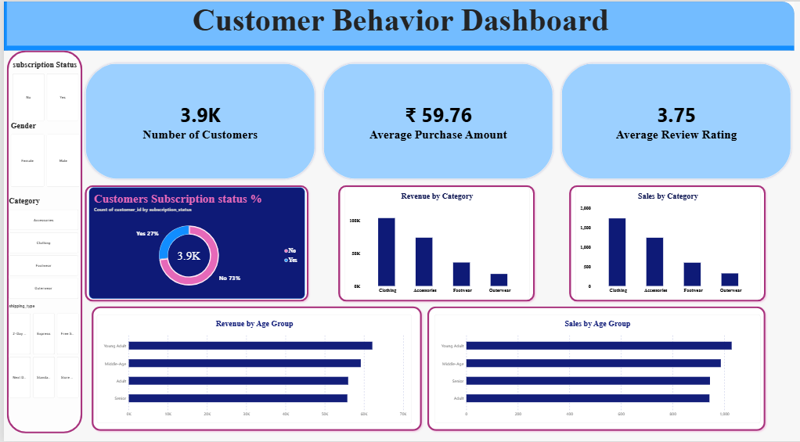

# Purchase Patterns: Customer Shopping Behavior Analysis

End-to-end analysis of 3,900 fashion-retail customers using **Python, PostgreSQL and Power BI**, to find out which levers (discounts, subscriptions, shipping) actually relate to spending.

<!-- Replace with your exported dashboard screenshot -->


## Business Question

A fashion retailer wants to know who its customers are, what they buy, and whether discounts, subscriptions and shipping options influence how much they spend, so it can make better marketing, pricing and product decisions.

## Key Insights

- **Subscribers don't spend more.** Average order is $59.49 for subscribers vs $59.87 for non-subscribers, and only 27% of customers are subscribed. Subscription is a loyalty lever, not a spend lever.
- **Acquisition is the gap, not retention.** 80% of customers have more than 10 previous purchases; only 2.1% are new.
- **Discount dependency is high on a few products.** Hat, Sneakers, Coat, Sweater and Pants are discounted on roughly half of their sales.
- **Clothing and Accessories drive about 76% of revenue** (total revenue: $233,081; average order: $59.76).
- **Loyal buyers rarely subscribe.** Only 28% of repeat buyers (more than 5 purchases) are subscribed, which is a conversion opportunity.
- **Male customers generate 68% of revenue,** but they are also 68% of the customer base, so per-customer spend is similar.

Full query-by-query results are in [`docs/project_documentation.pdf`](docs/project_documentation.pdf).

## Approach

1. **Clean and engineer features (Python / pandas):** filled 37 missing review ratings with the mean of each product category, standardised column names for SQL, dropped `promo_code_used` (identical to `discount_applied` on every row), and created `age_group` (quartile bins) and `purchase_frequency_days`.
2. **Load to PostgreSQL (SQLAlchemy):** the clean data goes into a `customer` table.
3. **Answer 10 business questions in SQL:** aggregations, subqueries, CASE segmentation, CTEs and window functions.
4. **Visualise in Power BI:** KPI cards, charts by category and age group, and slicers for subscription, gender, category and shipping type.

## Tech Stack

Python (pandas, SQLAlchemy, psycopg2) · PostgreSQL · Power BI (DAX) · Jupyter Notebook

## Repository Structure

```
├── data/        customer_shopping_behavior.csv
├── notebooks/   customer_behaviour_analysis.ipynb   # cleaning, features, DB load
├── sql/         customer_behaviour_queries.sql      # 10 queries with insights
├── dashboard/   customer_behaviour_dashboard.pbix
├── docs/        project_documentation.pdf
└── README.md
```

## How to Run

1. Install dependencies: `pip install pandas jupyter psycopg2-binary sqlalchemy`
2. Create an empty PostgreSQL database named `Customers_behaviour`.
3. Set your password as an environment variable: `export PG_PASSWORD="your_password"` (PowerShell: `$env:PG_PASSWORD="your_password"`).
4. Run `notebooks/customer_behaviour_analysis.ipynb` to clean the data and create the `customer` table.
5. Run the queries in `sql/customer_behaviour_queries.sql` (pgAdmin Query Tool).
6. Open the `.pbix` in Power BI Desktop and point it at your PostgreSQL instance.

## Author

**Mohd Rizwan**: [LinkedIn](https://www.linkedin.com/in/mohammedrizwan-ai/)
